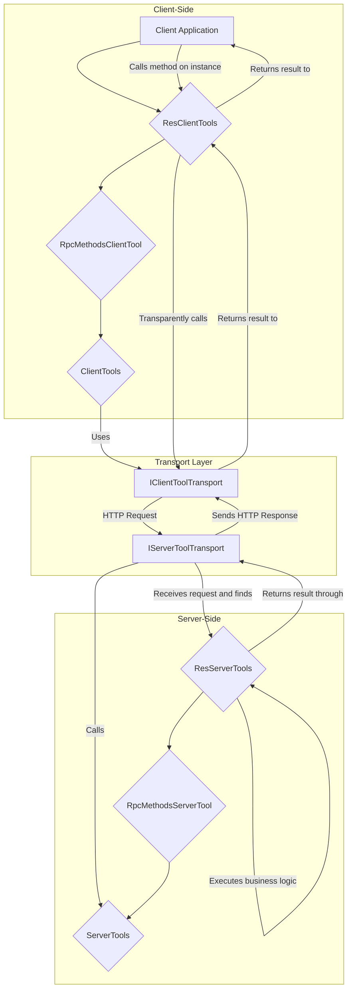

# @isdk/tool-rpc

`@isdk/tool-rpc` is a powerful TypeScript library that extends the modular capabilities of `@isdk/tool-func` to the network. It allows you to easily expose `ToolFunc` instances as a remote service and call them seamlessly from a client, just like local functions. It's perfect for building distributed AI agents, microservice architectures, or any scenario that requires tool invocation across different processes or machines.

This project is built on `@isdk/tool-func`. Before proceeding, please ensure you are familiar with its core concepts.

## ✨ Core Features

- **Trinity Architecture (V2.6+):** 
  - **RpcTransportManager**: Centralized registry for protocols, logical routing audit, and transport instance lifecycle.
  - **RpcServerDispatcher**: Decoupled execution engine with built-in concurrency isolation (Shadow Instances) and task tracking.
  - **RpcActiveTaskTracker**: Cross-protocol task visibility with retention policies and background execution support (102 Processing).
- **Layered Abstractions:** Provides a set of layered tool classes (`ServerTools`, `RpcMethodsServerTool`, `ResServerTools`) that allow you to choose the right level of abstraction for your needs.
- **🌐 RESTful Interface:** Quickly create REST-style APIs using `ResServerTools`, which automatically handles standard operations like `get`, `list`, `post`, `put`, and `delete`.
- **🔧 RPC Method Grouping:** Use `RpcMethodsServerTool` to bundle multiple related functions (methods) under a single tool, invoked via an `act` parameter.
- **🔌 Automatic Client-Side Proxies:** The client (`ClientTools` and its subclasses) can automatically load tool definitions from the server and dynamically generate type-safe proxy functions, making remote calls as simple as local ones.
- **🌐 Browser Compatible (`@isdk/tool-rpc/browser`):** A dedicated browser entry that includes client modules, abstract server-side classes (`ServerTools`, `RpcMethodsServerTool`, `ResServerTools`), and full transport infrastructure (`RpcServerDispatcher`, `RpcTransportManager`, `RpcActiveTaskTracker`, etc.). Only excludes Node.js-specific server transports (`HttpServerToolTransport`, `MailboxServerTransport`).
- **🚀 Built-in HTTP & Mailbox Transport:** 
  - **HTTP**: Comes with `HttpServerToolTransport` (Node.js `http`) and `HttpClientToolTransport` (`fetch`, browser-compatible).
  - **Mailbox**: Native support for internal distributed mailbox protocols, ideal for cross-process or cross-thread communication.
- **🚀 Multi-Instance Isolation:** Support for multiple transport instances with different `apiUrl`s in a single process without global state collision.
- **🛡️ Execution Guarding:** Integrated deadline management (Soft/Hard deadlines) and physical-to-logical abort linkage.
- **🌊 Streaming Support:** Both server and client support `ReadableStream` with full lifecycle management, including backpressure and automatic cleanup.

## 📦 Installation

```bash
npm install @isdk/tool-rpc @isdk/tool-func
```

## 🚀 Quick Start

The following example demonstrates how to create a RESTful tool, expose it on a server, and call it from a client.

### Step 1: Define the Server-Side Tool

Create a class that extends `ResServerTools`. Implement standard methods like `get` and `list`, as well as any custom business logic in methods prefixed with `$`.

```typescript
// ./tools/UserTool.ts
import { ResServerTools, ResServerFuncParams } from '@isdk/tool-rpc';
import { NotFoundError } from '@isdk/common-error';

// In-memory database for demonstration
const users: Record<string, any> = {
  '1': { id: '1', name: 'Alice' },
  '2': { id: '2', name: 'Bob' },
};

export class UserTool extends ResServerTools {
  // Standard RESTful method: GET /api/users/:id
  get({ id }: ResServerFuncParams) {
    const user = users[id as string];
    if (!user) throw new NotFoundError(id as string, 'user');
    return user;
  }

  // Standard RESTful method: GET /api/users
  list() {
    return Object.values(users);
  }

  // Custom RPC-style method
  $promote({ id }: ResServerFuncParams) {
    const user = users[id as string];
    if (!user) throw new NotFoundError(id as string, 'user');
    return { ...user, role: 'admin' };
  }
}
```

### Step 2: Set Up and Start the Server

In V2, we recommend using `RpcTransportManager` for lifecycle management and explicitly configuring the `RpcServerDispatcher`.

```typescript
// ./server.ts
import { HttpServerToolTransport, RpcTransportManager, RpcServerDispatcher, ServerTools } from '@isdk/tool-rpc';
import { UserTool } from './tools/UserTool';

async function startServer() {
  // 1. Register your tool instances in the global registry
  new UserTool('users').register();

  // 2. Initialize the transport with a dedicated Dispatcher
  const apiUrl = 'http://localhost:3000/api';
  const serverTransport = new HttpServerToolTransport({
    apiUrl,
    dispatcher: new RpcServerDispatcher({ registry: ServerTools.items })
  });

  // 3. Configure the logical routes for this transport
  // Expose the RPC endpoint for tool execution. Service discovery is built in
  // (the `rpcApis` tool answers `GET /api`), so no extra call is needed for it.
  serverTransport.addRpcHandler(apiUrl);

  // 4. Register the transport to the Manager and start all services
  RpcTransportManager.instance.registerServer(serverTransport);
  await RpcTransportManager.instance.startAll();

  console.log(`✅ Tool server started at ${apiUrl}`);
}

startServer();
```

### Step 3: Set Up and Use the Client

In V2, the client (`ResClientTools.loadFrom`) uses `RpcTransportManager` to automatically resolve and manage transport instances based on the `apiUrl`.

```typescript
// ./client.ts
import { HttpClientToolTransport, RpcTransportManager, ResClientTools } from '@isdk/tool-rpc';

// Define a type for full type-safety, including the custom method
type UserClientTool = ResClientTools & {
  promote(params: { id: string }): Promise<{ id: string; name: string; role: string }>;
};

async function main() {
  const apiUrl = 'http://localhost:3000/api';

  // 1. Register the HTTP scheme (needed if not globally pre-registered)
  RpcTransportManager.bindScheme('http', HttpClientToolTransport);

  // 2. Load API definitions from the server.
  // This automatically creates/uses a transport instance for the given apiUrl.
  await ResClientTools.loadFrom(undefined, { apiUrl });

  // 3. Get the dynamically created proxy for the remote tool.
  const userTool = ResClientTools.get('users') as UserClientTool;
  if (!userTool) {
    throw new Error('Remote tool "users" not found!');
  }

  // 4. Call the remote APIs as if they were local methods!

  // Calls GET /api/users/1
  const user = await userTool.get!({ id: '1' });
  console.log('Fetched User:', user); // { id: '1', name: 'Alice' }

  // Calls GET /api/users
  const allUsers = await userTool.list!();
  console.log('All Users:', allUsers); // [{...}, {...}]

  // Calls the custom RPC method $promote
  const admin = await userTool.promote({ id: '2' });
  console.log('Promoted User:', admin); // { id: '2', name: 'Bob', role: 'admin' }
}

main();
```

## Core Concepts: Layered Abstractions

The core design of `@isdk/tool-rpc` is a layered architecture that cleanly separates network communication from business logic. You can choose the right level of abstraction based on the complexity of your needs.

## 🏛️ Deep Architecture: Containers, Business, and Isolation

The architecture of `@isdk/tool-rpc` is built on a core philosophy: **Static classes as Containers, Instances as Business Functions.** This design balances global tool management with concrete business logic implementation.

### 1. The Duality Model

* **Container Classes (Plural 'Tools')**: e.g., `ServerTools`, `RpcMethodsServerTool`, `ResServerTools`.
  * **Role**: They act as static **Registries** and **Discovery Protocol Filters**.
  * **Responsibility**: Define level specifications, manage tool collections, and implement the `toJSON()` discovery algorithm. At the code level, they maintain global state via static properties (like `items`).
* **Business Instances (Singular 'Tool'/'Func')**: Instances created via `new ServerTools(...)` or its subclasses.
  * **Role**: They are the concrete **Functional Units**.
  * **Responsibility**: Host business logic (via the `func` method or `$`-prefixed RPC methods), and define parameter schemas (`params`) and metadata.

> **Naming Convention**: Class names use the plural (Tools) to reflect their container nature, while instances or derived business logic are conceptually singular (Tool/Func).

### 2. Discovery Isolation & Layered Compatibility

To ensure clients load accurate, protocol-matching tool definitions during the Discovery phase, the project implements a **hierarchical isolation mechanism**.

* **Isolation Algorithm**: The `toJSON()` method performs triple validation during registry traversal:
    1. **Type Check**: `item instanceof this` ensures the tool belongs to the current or a sub-level.
    2. **Protocol Reference Check**: Validates `item.constructor.toJSON === this.toJSON`. This ensures that if a subclass (like `RpcMethodsServerTool`) overrides `toJSON` for a more complex protocol, its instances will **not** be exported by the parent class (like `ServerTools`), preventing basic clients from loading tools they cannot handle.
    3. **Visibility Check**: `item.isApi !== false`.

* **Export Ranges by Level**:
  * **`ServerTools.toJSON()`**: Exports only direct instances of `ServerTools` and raw `ToolFunc` items marked as `isApi: true`. It **never** exports RPC or Resource tools.
  * **`RpcMethodsServerTool.toJSON()`**: Exports all RPC-style tools. Due to downward compatibility, it **includes** instances of subclasses like `ResServerTools`.
  * **`ResServerTools.toJSON()`**: Implements upward isolation, exporting only Resource tools and excluding general RPC methods from its parent.

* **Default Behavior for `isApi`**:
  * **For Derived Business Instances (Func)**: Since they are designed for remote exposure, they are **auto-exported** by default unless explicitly set to `isApi: false`.
  * **For Base `ToolFunc` Instances**: For security, they are **hidden** by default. You must explicitly set `isApi: true` to make them discoverable via `ServerTools`.



### 3. 🛡️ Concurrency Isolation (Shadow Instances)

V2 Architecture introduces **Shadow Instances** to solve `this.ctx` race conditions in asynchronous environments.
- When a request arrives, the `Dispatcher` creates a new instance using `Object.create(tool)`.
- **Property Shadowing**: `this.ctx = context` only affects the current execution instance, ensuring physical isolation during high concurrency while maintaining access to original tool properties.

### 4. 🚀 The Trinity Architecture (V2.6+)

The core of `@isdk/tool-rpc` is built around three decoupled components:

1.  **RpcTransportManager (The Registry & Lifecycle)**:
    - **Physical Mapping**: Manages `apiUrl` to `IToolTransport` instances.
    - **Routing Audit**: Performs `ListenAddr -> Set<RoutePath>` conflict detection to prevent route hijacking on shared physical ports.
2.  **RpcServerDispatcher (The Logic Engine)**:
    - **Normalization**: Translates protocol-specific objects into `ToolRpcContext`.
    - **Deadlines**: Implements Soft Deadlines (triggering `102 Processing` for background execution) and Hard Deadlines (Terminating task with `408`).
3.  **RpcActiveTaskTracker (The Task Ledger)**:
    - **Observability**: Tracks all active and background tasks across protocols.
    - **Retention**: Manages result retention policies (`Once`, `Permanent`, TTL).
    - **Abort Linkage**: Bridges `AbortSignal` from physical connections to the execution layer.

## 🛠️ Advanced Architecture: Hierarchical Registries and Polymorphism

For complex systems with plugin architectures or multi-tenant environments, `@isdk/tool-rpc` leverages the **Hierarchical Registries** of the underlying `@isdk/tool-func` to support sophisticated customization.

### 1. Registry Isolation & Inheritance

By calling `Tools.isolateRegistry()`, you branch the current registry into a new scope using prototype inheritance:

- **Inheritance**: Sub-registries can access all tools from the parent.
- **Locality**: New registrations are local to the current scope (and its descendants) and do not pollute the parent.
- **Use Case**: Assigning independent tool domains to different AI agent groups or isolating Server/Client registries in unit tests.

### 2. Shadowing & Polymorphism

You can register a tool with the same name as a parent in an isolated registry to create a **Shadow**:

- **Behavior**: Calls within the local scope use the new implementation; calls in the parent scope still use the original.
- **Use Case**: Allowing specific plugins to replace a standard atomic tool (e.g., changing a notification method from Email to Slack) without modifying core framework code.

### 3. Smart Binding Strategies

When a workflow tool depends on other tools via the `depends` property, the binding strategy determines how those dependencies are resolved:

* **`'auto'` (Default - Context-Aware)**: **The most intuitive mode for business logic.**
  - **Logic**: Switches to polymorphic late binding only if the caller is a descendant of the tool definer.
  - **Benefit**: Achieves "Local Customization, Global Stability". It allows plugins to modify a middle step of a workflow without breaking the parent system's internal stability.
* **`'early'` (Early Binding - Contract Protection)**:
  - **Logic**: Always uses the original dependency locked at registration time.
  - **Benefit**: Used for security-critical or core components (e.g., auth, crypto) to prevent them from being "hijacked" by downstream shadows.
* **`'late'` (Late Binding - Environment-First)**:
  - **Logic**: Forcefully resolves from the top-level registry of the current caller, ignoring lineage.
  - **Benefit**: Allows complete runtime injection based on the execution environment.

### 4. Namespace Protection

To prevent accidental shadowing, use `allowOverride: false` during registration. The registry will recursively check the prototype chain and throw an error if the name is already taken, protecting core APIs from being overwritten.

## ⚠️ Common Pitfalls

1. **Defining `func()` in `ResServerTools` subclasses**
    * **Consequence**: `ResServerTools` relies on `func` for REST/RPC dispatching. Overwriting it without calling `super.func` breaks `get/list/$method` routing.
    * **Best Practice**: Always implement business logic via `get()`, `list()`, or `$`-prefixed methods in the Resource layer.

2. **Treating `isApi: false` as a Firewall**
    * **Consequence**: `isApi: false` only affects the "Discovery" phase (hiding it from the client). If an attacker guesses the tool name and crafts a request, the transport layer will still execute it.
    * **Best Practice**: Implement authentication in your business logic or use the `_req` context for authorization.

3. **Missing Isolation in Single-Process Tests**
    * **Consequence**: Errors like `[ToolName] already registered as ServerTools`.
    * **Best Practice**: Use `ClientTools.isolateRegistry()` in your `beforeAll` hooks.

4. **Confusing Static 'Tools' vs. Instance 'Func' Responsibilities**
    * **Consequence**: Attempting to modify `ServerTools.items` within business logic, leading to global pollution.
    * **Best Practice**: Static members are for management; business logic should be strictly confined to `this` or `this.ctx` on the instance.

## ⏱️ Timeout Strategy

`@isdk/tool-rpc` tunes timeout control for distributed AI-agent scenarios and follows the *smallest timeout wins* principle.

### 1. Configuration Format

The `timeout` property accepts a shorthand and a longhand form:

- **Shorthand (number)**: milliseconds, treated as a hard deadline.
- **Longhand (object)**:
    - `value`: the hard deadline.
    - `streamIdleTimeout`: idle timeout for streaming (time to first byte, or the gap between chunks).
    - `keepAliveOnTimeout`: defaults to `false`. When set to `true`, the server returns the timeout error but lets the task keep running in the background.

### 2. Estimated Duration (expectedDuration)

This is a UX-friendly hint (an advisory signal, not an enforced constraint). Clients can use it to improve the loading experience:

- **Simulated progress**: move a progress bar smoothly across the `expectedDuration` window.
- **Smart retries**: if the call exceeds the estimate and the task is idempotent, the client may fire a concurrent redundant request.

## 🧠 Execution Context and Shadow Instances

To keep concurrent calls safe while decoupling business logic from environment details, the library uses a *prototype-chain shadow instance* mechanism.

### 1. Accessing `this.ctx`

Inside a tool, read environment details from `this.ctx` instead of mixing them into business `params`:

- `this.ctx.signal`: the automatically injected `AbortSignal`.
- `this.ctx._req` / `this.ctx._res`: the raw transport request/response objects.
- Custom fields: such as `traceId` or `userId`.

### 2. Chaining with `.with(ctx)`

On the client, `.with()` presets the environment for a single call or a series of calls:

```typescript
const runner = tool.with({ timeout: 2000, traceId: 'T123' });
await runner.run(params);
```

### Layer 1: `ServerTools` / `ClientTools` - The Basic Remote Function

This is the most fundamental layer, representing a single, remotely callable function.

- **`ServerTools`**:
  - **Concept**: An individual, remotely executable function.
  - **Use Case**: This is the simplest approach when you just need to expose a few scattered functions that don't have a strong relationship with each other.
  - **Advanced Usage**: Inside the `func`, you can access the raw HTTP request and response objects via `params._req` and `params._res` for lower-level control.
  - **Example**:

    ```typescript
    // server.ts
    new ServerTools({
      name: 'ping',
      isApi: true, // Mark as discoverable
      func: () => 'pong',
    }).register();
    ```

- **`ClientTools`**:
  - **Concept**: The client-side proxy for a `ServerTools` instance on the server.
  - **How it Works**: After `client.init()`, it creates a `ClientTools` instance named `ping`. When you call `ToolFunc.run('ping')`, it sends the request over the network to the server.

### Layer 2: `RpcMethodsServerTool` / `RpcMethodsClientTool` - The Object-Oriented Service

This layer organizes multiple related functions into a collection that resembles an "object" or "service".

- **`RpcMethodsServerTool`**:
  - **Concept**: A "service" object containing multiple callable methods. It acts as a dispatcher.
  - **Use Case**: Use this class to better organize your code when you have a group of cohesive operations (e.g., a `UserService` with `createUser`, `updateUser`, `getUser`).
  - **How it Works**: Methods defined in the class with a `$` prefix (e.g., `$createUser`) are automatically registered as RPC methods. The client specifies which method to call by passing `act: '$createUser'` in the request.
  - **Example**:

    ```typescript
    // server.ts
    class UserService extends RpcMethodsServerTool {
      $createUser({ name }) {
        // ... logic to create a user
        return { id: 'user-1', name };
      }
      $getUser({ id }) {
        // ... logic to get a user
        return { id, name: 'Test User' };
      }
    }
    new UserService('userService').register();
    ```

- **`RpcMethodsClientTool`**:
  - **Concept**: The client-side proxy for the remote service object.
  - **How it Works**: On initialization, it detects the `$createUser` and `$getUser` methods on the server and dynamically creates corresponding `createUser()` and `getUser()` methods on the client instance. This makes the invocation look like a local object method call, completely hiding the underlying `act` parameter and network communication.
  - **Example**:

    ```typescript
    // client.ts
    const userService = RpcMethodsClientTool.get('userService');
    const newUser = await userService.createUser({ name: 'Alice' });
    ```

### Layer 3: `ResServerTools` / `ResClientTools` - The RESTful Resource

This is the highest-level abstraction, providing a resource-centric, RESTful-style API on top of RPC.

- **`ResServerTools`**:
  - **Concept**: Represents a RESTful resource with built-in mapping for standard HTTP verbs (GET, POST, PUT, DELETE).
  - **Use Case**: Ideal for scenarios requiring standard CRUD (Create, Read, Update, Delete) operations, such as managing `users` or `products` resources.
  - **How it Works**: It extends `RpcMethodsServerTool` and pre-defines special methods like `get`, `list`, `post`, `put`, `delete`. The HTTP transport layer intelligently calls the appropriate method based on the request's `method` (GET/POST) and whether an `id` is present in the URL.
    - `GET /users/:id` -> `get({ id })`
    - `GET /users` -> `list()`
    - `POST /users` -> `post({ val })`
  - **Advanced Usage**: Since it extends `RpcMethodsServerTool`, you can still define custom `$` methods in a `ResServerTools` subclass, allowing you to combine RESTful patterns with specific RPC calls (as shown in the Quick Start example on this page).

- **`ResClientTools`**:
  - **Concept**: The client-side proxy for a remote RESTful resource.
  - **How it Works**: It provides a set of convenient methods like `.get()`, `.list()`, `.post()`, etc., which automatically construct and send requests that conform to REST semantics.
  - **Example**:

    ```typescript
    // client.ts
    const userRes = ResClientTools.get('users');
    const user = await userRes.get({ id: '1' }); // Sends GET /api/users/1
    const allUsers = await userRes.list();       // Sends GET /api/users
    ```

## 🌐 Browser Usage

`@isdk/tool-rpc/browser` is a dedicated browser entry point that ships client modules, server-side abstractions, and full transport infrastructure — except Node.js-specific server transports (`http`, `stream`, etc.) are excluded.

### Installation

```bash
npm install @isdk/tool-rpc
```

### Import from the browser entry

```typescript
import {
  // Client modules
  ClientTools,
  HttpClientToolTransport,
  RpcClientTransportManager,
  // Server-side abstractions
  ServerTools,
  RpcMethodsServerTool,
  ResServerTools,
  // Transport infrastructure
  RpcTransportManager,
  RpcServerDispatcher,
  RpcActiveTaskTracker,
  RPC_HEADERS,
} from '@isdk/tool-rpc/browser'

// Build a complete in-memory RPC server & client in the browser
RpcTransportManager.bindScheme('http', HttpClientToolTransport)

// Register a tool
ServerTools.register({
  name: 'greet',
  func: ({ name }) => `Hello, ${name}!`,
})

// Create a dispatcher
const dispatcher = new RpcServerDispatcher({ registry: ServerTools.items })

// Call remotely
await ClientTools.loadFrom(undefined, { apiUrl: 'http://localhost:3000/api/' })
const greet = ClientTools.get('greet')
const result = await greet.run({ name: 'Browser' })
```

### Key differences from Node.js

| Aspect | Node.js (`@isdk/tool-rpc`) | Browser (`@isdk/tool-rpc/browser`) |
|--------|---------------------------|-------------------------------------|
| Manager | `RpcTransportManager` (full version with server lifecycle) | `RpcTransportManager` + `RpcClientTransportManager` |
| Server transports | `HttpServerToolTransport`, `MailboxServerTransport` | Not included ❌ |
| Server-side abstractions | `ServerTools`, `RpcMethodsServerTool`, `ResServerTools` | All included ✅ |
| Transport infrastructure | `RpcServerDispatcher`, `RpcActiveTaskTracker`, `RpcDeadlineGuard` | All included ✅ |
| `uuid` generation | Via `@isdk/hash` (cross-platform) | Via `@isdk/hash` (cross-platform) |
| Bundle size | Larger (includes Node.js server transports) | Smaller (omits Node-`http`/`mailbox` transports)

### Bundler auto-resolution

When using bundlers (webpack 5+, Rollup, Vite), the `browser` field in `package.json` automatically resolves `@isdk/tool-rpc` to the browser entry. This means you can also write:

```typescript
// Bundlers automatically resolve to the browser entry
import { ClientTools } from '@isdk/tool-rpc'
```

## 🔌 The Transport Layer

The transport layer is a core pillar of `@isdk/tool-rpc`, acting as the communication bridge between server tools and client tools to enable true Remote Procedure Calls (RPC).

### Design Philosophy

The core design philosophy of the transport layer is the **separation of concerns**. It completely decouples the business logic of your tools (what you define in a `Tool`) from the implementation details of network communication (like protocol, routing, and serialization). This keeps your tool code pure and portable, without needing to know whether it's communicating over HTTP, WebSockets, or any other protocol. You define what your tool does, and the transport layer handles the rest.

### Core Abstractions

The architecture is built around a few key interfaces:

- **`IToolTransport`**: The common base interface for all transports, defining basic operations like `mount`.
- **`IServerToolTransport`**: The interface that a server-side transport must implement. Its core responsibilities are:
    1. **Exposing a Discovery Endpoint**: The route that lists the tools (typically `GET /api`) is served by the framework's built-in `rpcApis` tool, registered automatically for every claimed prefix. It is an ordinary tool: it goes through the same identity, validation and timeout pipeline as business calls, and it lists the registry bound to the **matched prefix**. `addDiscoveryHandler(apiUrl, handler)` is **deprecated** — it only overrides the listing content for that prefix, and the first call logs a one-time migration warning. Keep it only when the listing itself must be customized (or register your own tool with `addRoute(apiUrl, { path: '/', when: { method: 'GET' }, toolId: 'myListing' })`).
    2. **Handling RPC Calls**: Create a generic RPC route (e.g., `/api/:toolId`) that receives requests, finds the corresponding tool by `toolId`, executes it, and returns the result. This is handled by the `addRpcHandler` method.
    3. Managing the server lifecycle (`start`, `stop`).
    4. **Physical Awareness (V2)**: Methods like `getListenAddr()` and `getRoutes()` allow for physical port reuse and logical route ownership registration.
    5. **Route Claims & Remount (V2)**: `addRpcHandler()` / `addDiscoveryHandler()` claim their path prefix in the `ServerToolTransport` base class, so one transport can serve several prefixes, each with its own registry and discovery handler. Logical routes are reported in canonical form (leading `/`, no trailing slash); the trailing-slash form used for prefix matching is derived by `toMatchPrefix()`. Re-declaring an already claimed prefix replaces its registry/handler and logs a warning; pass `options.remount = 'throw'` to raise an error instead — backends with their own router override `onDuplicateRoute()` to surface a native duplicate-route error.
    6. **Route Table (V2)**: `addRoute(apiUrl, { path, when, toolId, act })` maps a path inside a prefix to a tool, and `getRouteTable()` returns every row (including the built-in discovery rows) so adapters can register them natively. The built-in discovery endpoint is just a row in that table — a third party overrides it by declaring the same path and condition, with no privileged channel. `path: ''` and `'/'` are the same route; `/x` and `/x/` are the same unless `strictTrailingSlash: true`.
    7. **Route Registration Pair (V2)**: `registerRoutes()` / `unregisterRoutes()` — `protected` members of the `ServerToolTransport` base class, called from inside your own transport subclass — keep the physical route table and the Manager's ownership table in sync, and are re-entrant (they unregister first, then register). Framework adapters (Fastify, Electron, Express) should call this pair rather than `claimRoute()` alone — claiming routes without touching the ownership table leaves stale entries that make the next `listen()` fail with `Routing Conflict`. On the Manager side the matching pair is `registerServer()` / `unregisterServer()` (the old name `addServer()` is deprecated and only forwards); `unregisterServer()` clears ownership and the transport mapping but does **not** stop the underlying server.
- **`IClientToolTransport`**: The interface that a client-side transport must implement. Its core responsibilities are:
    1. **Loading API Definitions**: Call the `loadApis()` method, which accesses the server's discovery endpoint to get the definitions of all tools.
    2. **Executing Remote Calls**: Implement the `fetch()` method, which is responsible for serializing the client's tool call (function name and parameters), sending it to the server's RPC endpoint, and processing the response.
    3. **Background Lifecycle (V2)**: Support for **Polling (102 Processing)** and **Logical Cancellation** linked to `AbortSignal`.

### Built-in Transports

The library provides plug-and-play transport implementations:

- **`HttpServerToolTransport` (HTTP server)**: Built on Node.js's built-in `http` module. In V2 it supports **Longest Prefix Match** routing, letting several logical instances share one physical port (physical base reuse). It automatically:
    - Answers `GET /prefix` with the built-in `rpcApis` tool. It is an ordinary tool in the route table, so it
      passes the same identity, validation and timeout pipeline as business calls (see
      [Identity Policy](#-identity-policy)); it is public by default, and a policy can require a credential for it.
    - Creates an RPC route that carries the tool name, resolving arguments from the request body or URL parameters.
- **`HttpClientToolTransport` (HTTP client)**: Built on the cross-platform `fetch` API. The V2 version polls background-task status automatically.
- **`Mailbox Transports`**: Native support for the internal distributed mailbox protocol.
    - **Characteristics**: suited to cross-process or cross-thread communication, with physical isolation built in.
    - **Advantage**: high-performance tool calls in scenarios that need no HTTP stack.

### Extending the Functionality: Creating Your Own Transport

`@isdk/tool-rpc` is designed to be fully extensible. You can create your own transport layer to support different protocols (like WebSockets, gRPC) or to integrate with existing web frameworks (like Express, Koa, or Fastify) by implementing the interfaces described above.

**Idea for a Fastify Integration**:

1. Create a `FastifyServerTransport` class that implements `IServerToolTransport`.
2. In the `mount` method, instead of creating a new `http` server, you would accept an existing `FastifyInstance` as an option.
3. Read `transport.getRouteTable()` and register each row natively (`fastify.get(prefix + path, ...)`) — the built-in discovery endpoint is one of those rows, so you do not hand-code a `ServerTools.toJSON()` handler.
4. Use `fastify.all(apiPrefix + '/:toolId', ...)` to register the RPC route. The handler would extract parameters from `request.body` or `request.query`, call the appropriate tool, and use `reply` to send the response.
5. The `start` and `stop` methods could delegate to the Fastify instance's `listen` and `close` methods.

This pluggable architecture gives `@isdk/tool-rpc` immense flexibility, allowing it to easily adapt to various project requirements and tech stacks.

## 🪪 Identity Policy

The server has to answer one question: **who is this request**. This package defines the interface plus two
default implementations. **Without a policy the behaviour is byte-for-byte what it always was** (`clientId` is
whatever the client self-reports, `ctx.identity` is `undefined`).

### The two default implementations

**A. `RpcSessionIdentityPolicy`** — the server issues a session credential on first connect. Once connected the
identity cannot be spoofed (the server decides, the client cannot self-report), and disconnects can resume.
**It does not authenticate** (anyone can connect).

```typescript
import { HttpServerToolTransport, RpcSessionIdentityPolicy } from '@isdk/tool-rpc';

new HttpServerToolTransport({ apiUrl: '/api', identity: new RpcSessionIdentityPolicy() });
```

**B. `RpcBearerPolicy`** — credentials are issued elsewhere (JWT / OAuth2 access token / your own api key);
the server only verifies them. **It does authenticate**; stateless, so it works across replicas out of the box.

```typescript
const identity = new RpcBearerPolicy({
  verify: async (token) => {
    const p = await jwt.verify(token, JWKS);
    return p ? { id: p.sub, attributes: { scopes: p.scopes } } : undefined;
  },
  allowAnonymous: false,   // reject with 401 instead of handing out an anonymous identity
});
new HttpServerToolTransport({ apiUrl: '/api', identity });
```

| | `RpcSessionIdentityPolicy` | `RpcBearerPolicy` |
|---|---|---|
| Authentication (who may connect) | No | Yes (`verify` rejects with 401) |
| Anti-spoofing once connected | Yes | Yes, but a credential-less connection has no resumable identity |
| Where credentials come from | Issued by the server on first connect | Provided by the deployment (auth service / admin plane) |
| State | In-process credential registry | Stateless |
| Across replicas | In-process by default → sticky sessions; swap the `registry` to share | Works as-is |
| Granularity of `id` | Per connection (uuid by default) | Decided by `verify`: a user-level id merges downstream sessions |
| Semantics | Identifies "which session" only, carries no authorization | Carries attributes from the authenticating side (scopes / tenant) |

> **`id: p.sub` has a cost.** A user-level stable id lands in `clientId`. On transports that key their session
> tables by clientId (SSE-style ones), **several tabs and devices of the same user merge into one session**.
> Plain request/response HTTP RPC is unaffected. For a user-level identity with per-connection sessions, use
> `id: uuidv4()` plus `attributes: { userId: p.sub }`.

### Per-API authentication decisions

`allowAnonymous` accepts a **predicate** as well as a boolean, so the granularity can be a single API:

```typescript
const identity = new RpcBearerPolicy({
  verify: (token) => verifyToken(token),
  // public by default: only tools carrying an authScope require a credential; discovery is let through
  allowAnonymous: (ctx) => ctx.toolId === 'rpcApis' || !ctx.tool?.authScope,
});
```

The `ctx` the predicate receives is the addressing result for this call: `toolId` / `act` / `resId`,
`prefix` / `apiUrl` (multi-prefix tenancy), plus `tool` — the instance from the registry (read-only supply,
resolved in the same order the dispatcher uses; `undefined` when it cannot be found). The framework's own
discovery endpoint is addressed as `toolId === 'rpcApis'`; it has no separate flag, because it is an ordinary
tool. So "does this API require a credential" can live where the tool is registered:

```typescript
class AdminTool extends ServerTools {
  authScope = 'admin'          // the field name is a private convention between deployment and business code
  func(params, ctx) { /* … */ }
}
```

Three boundaries:

- **The field on the tool does nothing by itself.** The framework reads no fields off `tool`, so writing
  `allowAnonymous = true` at registration has no effect until a policy reads it:
  `allowAnonymous: (ctx) => (ctx.tool as any)?.allowAnonymous === true` — that form is what the tests pin down
  (`src/transports/identity-server.test.ts`). Any name works (`authScope` above, `publicAccess`, …); the predicate
  is what gives it meaning, and `ctx.tool` can be `undefined`, so decide what that case means.
- This is **authentication** (does this call need a credential), not **authorization** (who may call which
  tool). Authorization stays in `validateRpcRequest` and in the business tools.
- **Discovery is a built-in tool (`rpcApis`)**, not a special route: it goes through the same pipeline as any
  call (`match` → `assign` when needed; only a policy throwing produces a 401). It is public by default; make it
  require a credential by returning `false` for `ctx.toolId === 'rpcApis'` in the predicate. On the client,
  `ClientTools.loadFrom()` merges the class-level `fetchOptions` (where the credential lives) into the discovery
  call, otherwise an authenticated discovery endpoint would return no tool list.

### Reading it in business code

Identity lands in exactly one place, `ctx.identity`:

```typescript
ServerTools.register({
  name: 'whoami',
  func: (params, ctx) => ({ who: ctx.identity?.id, scopes: ctx.identity?.attributes?.scopes }),
});
```

The client brings the credential back (which header carries it is the deployment's transport's call; the bearer
default reads `authorization`):

```typescript
await someTool.run({ q: 1 }, { headers: { authorization: `Bearer ${token}` } });
```

### The policy interface

To plug in an auth-proxy header / mTLS certificate mapping / your own auth service, implement the two hooks of
`RpcIdentityPolicy`:

```typescript
class ProxyHeaderPolicy implements RpcIdentityPolicy<IncomingMessage> {
  readonly name = 'proxy-header';
  match(ctx: RpcIdentityContext<IncomingMessage>) {
    const t = ctx.credential;
    if (!t) return undefined;                       // undefined = start a new session, not a rejection
    return { id: t.slice(0, 16), attributes: { tenant: ctx.headers?.['x-tenant'] } };
  }
  assign() { return { id: uuidv4() }; }
}

new HttpServerToolTransport({
  apiUrl: '/api',
  identity: new ProxyHeaderPolicy(),
  credentialReader: (r) => r.headers['x-auth'],      // private headers: write your own reader
});
```

Key rules (the full contract list lives in `IDENTITY_POLICY_DESIGN.cn.md` at the repository root):

- `match` returning `undefined` means "start a new session"; **a rejection must throw**
  `new RpcError('Unauthenticated', RpcStatusCode.UNAUTHENTICATED, 'unauthenticated')` (401).
- `match` and `assign` are two separate judgments and cannot be merged; all three hooks may be sync or async.
- Both default classes are subclassable (swap `verify` / id generation / add attributes in 3–8 lines);
  every override point is `protected`.
- Storage for server-issued credentials is swappable: implement the four `RpcCredentialRegistry` methods and
  inject it through the `registry` option (persistence / cross-process sharing / Redis / LRU eviction).
- "Who may call which tool" is not the policy's job — put it in `manager.validateRpcRequest` or in the tool.

## Advanced Usage

This section covers some of the more powerful features of `@isdk/tool-rpc` for building flexible and efficient applications.

### Exporting Functions for Client-Side Execution

In some scenarios, you might want to offload computation from the server or allow the client to execute a function locally. The `allowExportFunc` option enables this by serializing the function's body and sending it to the client during the discovery phase. When set to `true`, the client-side `ClientTools` will automatically use this downloaded function instead of making a network request.

**Server-Side Configuration:**

```typescript
// server.ts
new ServerTools({
  name: 'local-uuid',
  isApi: true,
  allowExportFunc: true, // Allow this function to be downloaded
  func: () => {
    // This logic will be executed on the client
    console.log('Generating UUID on the client...');
    return Math.random().toString(36).substring(2, 15);
  },
}).register();
```

**Client-Side Usage:**

```typescript
// client.ts
const uuidTool = ClientTools.get('local-uuid');
// This call executes the downloaded function body. No network request is made.
const uuid = await uuidTool.run();
console.log('Generated UUID:', uuid);
```

### Automatic RESTful Method Routing

When using `ResServerTools`, the framework intelligently routes incoming HTTP requests. It inspects the HTTP method and the presence of an `id` parameter to determine which function to call. This logic, handled by `getMethodFromParams` within the tool, provides the following mappings out-of-the-box:

- `GET /api/my-resource` → `list()`
- `GET /api/my-resource/123` → `get({ id: '123' })`
- `POST /api/my-resource` → `post({ val: ... })`

This allows you to write clean, resource-oriented code without worrying about manual routing.

### Hybrid RESTful and RPC Tools

Since `ResServerTools` extends `RpcMethodsServerTool`, you can combine both API styles in a single tool. You can implement standard RESTful methods (`get`, `list`) while also adding custom RPC-style methods (e.g., `$archive`, `$publish`) for specific business operations that don't fit the CRUD model.

### Automatic Parameter Type Casting

The `params` schema you define on a tool is used for more than just documentation. The server automatically uses it to cast incoming parameters to their specified types. For example, if you define `id: { type: 'number' }`, any `id` received from a URL path (which is a string) will be converted to a `Number` before your function is called.

### Client-Side Method Aliasing

For convenience, when you define a method with a `$` prefix on the server (e.g., `$promoteUser`), the client-side proxy automatically creates a cleaner alias without the prefix. This allows you to call `myTool.promoteUser(...)` on the client, making the code more readable and idiomatic.

### 🛡️ Cross-Process Cleanup

When a timeout fires, or the client disconnects while `keepAliveOnTimeout` is `false`:

1. The server automatically fires the `abort` event on `this.ctx.signal`.
2. Tool functions should listen for that signal to stop expensive work (AI model inference, long queries).
3. The transport layer makes sure every associated connection is closed.

```typescript
async func(params) {
  this.ctx.signal.addEventListener('abort', () => {
    // Stop the local long-running task
  });
}
```

## 🤝 Contributing

We welcome contributions of all kinds! Please read the [CONTRIBUTING.md](./CONTRIBUTING.md) file for guidelines on how to get started.

## 📄 License

This project is licensed under the MIT License. See the [LICENSE-MIT](./LICENSE-MIT) file for more details.
