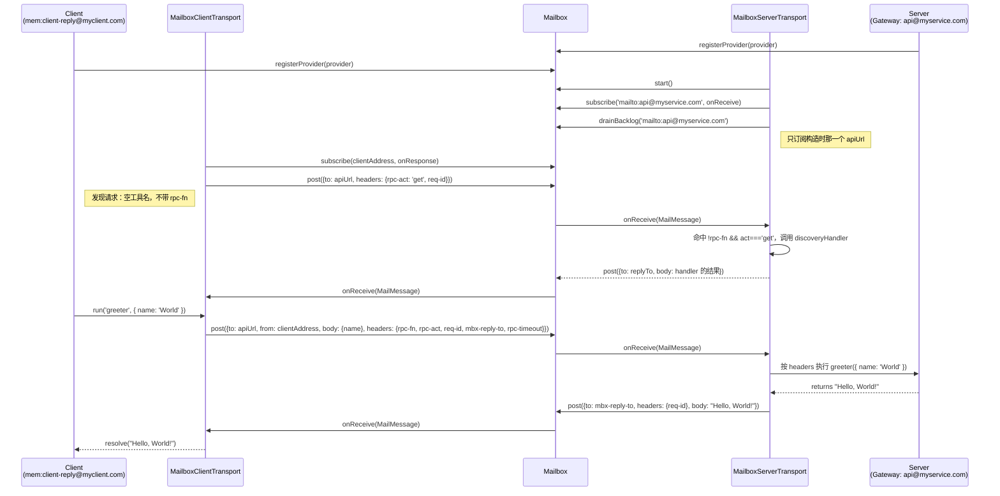

# 与 `@isdk/tool-rpc` 的集成

> **先读这段：本文分两类内容。**
> - **已实现**（第 1–6 节）：逐条对着代码写，附 `文件:行`，可照抄。
> - **设计约定（未实现）**（第 7 节）：值得实现但代码里还没有，**不要照它写代码**。
>
> 权威来源是 `src/transports/mailbox-server.ts` / `src/transports/mailbox-client.ts`；超时与异步任务语义见 `tool-rpc-timeout-spec.cn.md`；mailbox 底座见 `@mboxlabs/mailbox`（注意：旧版本文写作 `@isdk/mailbox`，那是错的）。

## 1. 网关模式与服务发现

集成采用**网关模式 (Gateway Pattern)**：物理网关地址与逻辑收件人别名分离。

**核心约定：网关模式是默认且推荐的路由方式。除非有明确的必要性，否则不应改变此约定。**

- **逻辑地址 / 收件人别名 (Logical Address / Recipient Alias)**: 统一采用 `user@domain` 格式，代表一个**协议无关的服务标识符**。`user` 是目标工具名（`greeter`），`domain` 是服务所在的**逻辑域**（`myservice.com`）。
- **物理网关地址 (Physical Gateway Address)**: 每个 Provider 暴露一个稳定的入口地址，格式 `protocol:api@domain`。发往该 `domain` 的不同工具的请求，都送到这个统一物理地址。

### 1.1 Provider 的身份约定

每个 `IMailboxProvider` 扮演一个**网关 (Gateway)**：它有一个物理入口地址，客户端把请求投递到该地址。

**已实现的部分**：本包侧的「监听地址」就是 Transport 的 `apiUrl`——`MailboxServerTransport` 把它同时当作 API 地址与监听地址（`mailbox-server.ts:38-39`），回信时也以它作 `from`（`:168`）。

**未实现的部分（见 7.4）**：`IMailboxProvider` 上声明 `listenAddress` 与 `servedAddressPatterns`（正文旧版还出现过 `servedDomains` 这个别名，指同一件事）。`@mboxlabs/mailbox` 的接口里**没有这些字段**（`IMailboxProvider` 全文见 `@mboxlabs/mailbox/src/interfaces.ts:120-162`），所以「一个物理地址映射多个逻辑域」目前只能靠 Provider 自己的配置约定，接口层不承载。

### 1.2 服务端：监听网关

```typescript
// server.ts（应用入口）
import { MailboxServerTransport, ServerTools } from '@isdk/tool-rpc'

// 1. 注册与网络无关的服务函数
new ServerTools({ name: 'greeter', isApi: true, func: (p: {name: string}) => `Hello, ${p.name}!` }).register()

// 2. 初始化 ServerTransport（apiUrl 是正名；`address` 已 @deprecated，见 mailbox-server.ts:8）
const serverTransport = new MailboxServerTransport({
  mailbox,                      // 可选；不传则 Transport 自建一个并在 stop() 时关闭
  apiUrl: 'mailto:api@myservice.com' // 物理网关地址
})

// 3. 声明发现路由（**必须显式声明**，没有内置的 system.discover 服务）
serverTransport.addDiscoveryHandler('mailto:api@myservice.com', () => ServerTools.toJSON())

await serverTransport.start()
```

`start()` 的实际行为（`mailbox-server.ts:182-196`）：

1. 只订阅**构造时那一个** `apiUrl`（`mailbox.subscribe(address, onReceive)`，`:192`）。旧版本文写「遍历所有 Provider 并订阅各自的 listenAddress」——代码不做这件事，协议选择交给 mailbox 底座。
2. 订阅之后立刻 `drainBacklog(address)` 清积压（`:193`），保证「先接新信、再收旧信」的顺序。
3. `onReceive` 按 **headers** 解析目标（`:77-90`）：`rpc-fn` 决定工具，`rpc-act` 决定动作。
4. 发现请求的判定是 `!rpc-fn && (rpc-act === 'list' || rpc-act === 'get')`（`:79`），命中后调用 `addDiscoveryHandler` 登记的 handler。
5. 路由独占：`getRoutes()` 恒返回 `['/']`（`:58`）——同一 mailbox 地址只允许一个服务端实例，声明具体前缀不会缩小独占范围。

> 旧版本文第 (f) 条「路由时把 Headers 中的空字符串清理为 `undefined`」：代码没有这一步，也不需要——空串在 falsy 检查下等价于缺失（客户端 `if (name)` 才写 `rpc-fn`，`mailbox-client.ts:112`；服务端 `if (!toolId)` 直接 `BAD_REQUEST`，`mailbox-server.ts:125-126`）。

### 1.3 客户端：发现与调用

```typescript
// client.ts
import { MailboxClientTransport, ClientTools } from '@isdk/tool-rpc'

// 构造函数是**单个 options 对象**（mailbox-client.ts:34）；
// `serverAddress` / `apiRoot` 是 apiUrl 的别名（:35），新代码请用 apiUrl
const clientTransport = new MailboxClientTransport({
  mailbox,
  apiUrl: 'mailto:api@myservice.com',   // 物理网关地址（必填）
  clientAddress: 'mailto:user@myclient.com', // 自己的接收地址（必填，:40-42）
  timeout: 30000                        // 可选，见第 4 节
})

await ClientTools.loadFrom(undefined, { apiUrl: 'mailto:api@myservice.com' })
const greeter = ClientTools.get('greeter')
const result = await greeter.run({ name: 'World' })
```

发现阶段的实际行为：`ClientTools.loadFrom` → `transport.loadApis` → `fetch('', undefined, 'get')`（`client.ts:41-47`）——**空工具名 + `rpc-act: 'get'`，不带 `rpc-fn`**。旧版本文写的「携带 `Action: 'list'`」服务端也接受（`:79`），「携带 `rpc-fn: 'system.discover'`」代码里没有。

调用阶段的实际行为：`_fetch` 把请求发往**构造时那个 `serverAddress`**（`:104`），工具名走 `rpc-fn` 头，**不在地址上追加路径**。旧版本文的 `mem:api@myservice.com/greeter` 与第 1.4 节「只用 headers 路由」自相矛盾，以 headers 为准。

> 旧版本文里的 `protocolPreference`（协议偏好）与「服务地图里的 `gateways` 映射 + 选最佳协议」在代码里**不存在**（全仓无 `protocolPreference` / `gatewayMap` / `gateways`）。该设计见 7.2。

### 1.4 tool-rpc 路由规范：统一标准化消息头

头名以 `src/transports/models.ts:6-27` 的 `RPC_HEADERS` 为准：

| 消息头 | 常量 | 说明 | 强制性（代码事实） |
|--------|------|------|------|
| `rpc-fn` | `TOOL_ID` | 工具/函数标识符 | **强制**：缺失即 `BAD_REQUEST`（`mailbox-server.ts:125-126`） |
| `rpc-act` | `ACT` | 动作（get/post/list…） | 可选：缺省由 `ActionNames` 落到 `post`（`consts.ts:26-28`），服务端不校验 |
| `req-id` | `REQUEST_ID` | 请求/关联 ID | 严格模式强制，缺失 `BAD_REQUEST`（`:130`）；`options.strict === false` 时用消息 `id` 补齐（`:123`） |
| `trace-id` | `TRACE_ID` | 全链路追踪 ID | 可选 |
| `rpc-res-id` | `RES_ID` | 资源标识符 | 可选（**旧版本文写作 `rpc-res`，代码是 `rpc-res-id`**） |
| `rpc-timeout` | `TIMEOUT` | 客户端声明的执行超时 (ms) | 可选；服务端读它建 deadline（`dispatcher.ts:157`） |
| `rpc-retry-after` | `RETRY_AFTER` | 102 任务的轮询间隔参考 (ms) | 服务端下发（`dispatcher.ts:288`） |
| `rpc-client-id` | `CLIENT_ID` | 客户端标识（session 识别） | 可选 |
| `mbx-reply-to` | —（mailbox 层） | 响应应发往的地址 | 可选；客户端自动带上（`mailbox-client.ts:108`） |
| `mbx-sent-at` | —（mailbox 层） | 发送时间戳，由 Provider 注入 | 由 mailbox 底座负责 |

服务端还会注入三个只读追踪头：`x-mailbox-from` / `x-mailbox-to` / `x-mailbox-msg-id`（`mailbox-server.ts:114-116`）。

**统一路由策略**：`MailboxServerTransport` **仅通过 Headers** 解析目标工具、动作与资源 ID。

**为什么不使用逻辑地址 (URL Path) 进行路由？** `MailAddress` 支持形如 `/tool-name` 的逻辑路径，但底层协议（SMTP、若干 MQ）对路径的支持碎片化，依赖路径会在切换协议时产生不一致行为。Headers 是 `MailMessage` 的标准组成部分，任何协议都能可靠传递，因此路由元数据上移到 `headers`。

## 2. 工作流程：一次完整的异步 RPC 调用

1. **配置阶段**
   - 服务端：创建 `Mailbox`，注册 Provider；`MailboxServerTransport({ mailbox, apiUrl })`，并 `addDiscoveryHandler(apiUrl, handler)`。
   - 客户端：创建 `Mailbox`；`MailboxClientTransport({ mailbox, apiUrl, clientAddress, timeout? })`。

2. **启动与发现阶段**
   - 服务端 `start()`：`subscribe(apiUrl)` → `drainBacklog(apiUrl)`（`:192-193`）。
   - 客户端 `ClientTools.loadFrom()` → 发一封**无 `rpc-fn`、`rpc-act: 'get'`** 的信到 `apiUrl`。
   - 服务端命中发现分支（`:79`），调用 handler，回信 body **直接是 handler 的结果**（`sendRpcResponse` 走 `resultBody = rpcRes.data`，`:161`）。旧版本文写的 `{ tools, gateways }` 服务地图形状不存在——handler 返回什么，body 就是什么（典型实现是 `ServerTools.toJSON()`，即工具定义表）。

3. **调用阶段**（`mailbox-client.ts:103-161`）
   - `req-id`：优先用调用方传入的 `fetchOptions.headers['req-id']`，否则 `uuidv4()`（来自 `@isdk/hash`，不是 `uuid` 包）。
   - headers：`req-id`、`mbx-reply-to`、`rpc-fn`、`rpc-act`、`rpc-res-id`（按需）。
   - `to`：构造时的 `serverAddress`；`from`：`clientAddress`；`body`：参数。
   - **不设置消息 `id`**（内容级幂等未实现，见 7.1）。
   - `mailbox.post(...)`，失败时清定时器并 reject（`:157-161`）。

4. **处理阶段**
   - 服务端 `toRpcRequest` 归一化 headers（数组 `join(',')`、强制 `String(v)`、注入 `x-mailbox-*`，`:100-116`），校验 `rpc-fn` 与 `req-id`，交给 `RpcServerDispatcher`。
   - 请求级去重在这里是**硬冲突检测**：同一 `req-id` 二次进入活动任务表会抛 `CONFLICT`（`task-tracker.ts:188-192`）。

5. **响应阶段**（`mailbox-server.ts:164-176`）
   - `to`：优先 `mbx-reply-to`，无则回退请求的 `from`（`:167`）；`from`：`listenAddress`，无则回退请求的 `to`（`:168`）。
   - headers 回显 `req-id`（缺失时回退消息 `id`，`:164`），并带 `content-type: application/json`。
   - body：成功是结果本身；出错是 `{ error: { message, code, status, data } }`（`:151-159`）。

6. **完成阶段**
   - 客户端 `onResponse` 用 `req-id` 找到 pending 条目，清定时器、删除记录，然后结算（`:65-91`）。

## 3. 优势与价值

- **高度安全**：认证信息与地址分离，凭证由 Provider 在配置阶段内部管理。
- **终极解耦**：上层业务逻辑与底层通信协议、认证方式完全解耦。
- **统一通信模型**：`Mailbox` 不仅承载 RPC，也可作为 `@isdk/tool-event` 等发布/订阅系统的底层传输。
- **协议灵活性**：新增 Provider 即支持新协议。
- **简化测试**：`MemoryProvider` 可在单进程内测试整个分布式系统。
- **异步与离线**：天然适合事件驱动、响应式乃至离线系统。
- **生命周期所有权 (Ownership)**：「谁创建，谁负责」。Transport 内部自建的 Mailbox 随 `stop()` 关闭，外部传入的共享 Mailbox 不受影响——`isInternalMailbox` 双端一致（`mailbox-client.ts:47,185-186`；`mailbox-server.ts:31,241`）。服务端 `stop()` 还会释放路由归属，避免该地址永久占位导致下一个实例 `registerServer` 报 Routing Conflict（`mailbox-server.ts:236`）。

## 4. 消息跟踪机制实现细节

### 4.1 核心组件与内部状态

```typescript
// MailboxClientTransport 内部（mailbox-client.ts:26-32）
interface PendingRequest {
  resolve: (value: any) => void
  reject: (reason: any) => void
  timer: any
}

protected pendingRequests: Map<string, PendingRequest> = new Map()
protected timeout: number | { value: number; streamIdleTimeout?: number; keepAliveOnTimeout?: boolean }
protected serverAddress: string   // 字符串，不是 URL 对象
protected clientAddress: string
protected isInternalMailbox = false
```

`pendingRequests` 的键是 `req-id`（关联 ID），不是消息 `id`。

### 4.2 超时：双端协商，不是单点常量

旧版本文写「固定 `defaultTimeout = 30000`」。代码是协商模型（详见 `tool-rpc-timeout-spec.cn.md`）：

1. **优先级**：本次请求的 `fetchOptions.timeout` > 构造时的 `options.timeout` > 默认 30000（`mailbox-client.ts:116-121`）。`timeout` 可以是数字，也可以是 `{ value, streamIdleTimeout, keepAliveOnTimeout }`。
2. **传给服务端**：显式声明时写进 `rpc-timeout` 头（`:122`），服务端读它建立执行 deadline（`dispatcher.ts:157`）。
3. **本地兜底**：本地定时器 = 协商值 **+ 200ms**（`:125`），避免「服务端已回 102、客户端先超时」的竞态；超时 reject 带 `code = 504`（`:145`）。
4. **取消**：`fetchOptions.signal` 触发时 reject `AbortError`（`code = 20`），并预检 `signal.aborted`（`:126-133`）。

### 4.3 102 PROCESSING 与轮询（旧版本文整块缺失）

长任务不在响应里阻塞：服务端返回 `status: 102` 与 `rpc-retry-after`（`dispatcher.ts:288`），客户端按该间隔轮询 `rpcTask`（`client.ts:151-152,209`，轮询请求会删掉 `rpc-timeout`，`:198`）。`keepAliveOnTimeout` 为真时，服务端超时转成 102 保活而不是直接失败（`dispatcher.ts:237-241,275`）。客户端收到 102 直接 `resolve(body)`，把任务句柄交给上层（`mailbox-client.ts:74-76`）。

### 4.4 接收响应（`onResponse`）

1. 取 `headers['req-id']`；**不在 `pendingRequests` 里就静默忽略**（`:65-67`）。旧版本文写「`console.warn` 记录未知回复」，代码不记——mailbox 是广播信道，无关回信是常态，刷日志比故障本身还响。
2. 命中后清定时器、删记录（`:68-70`）。
3. 结算：
   - `status === 102`（或 `error.code === 102`）→ `resolve(body)`（`:74-76`）。
   - 有 `error` → 构造 `Error` 并挂 `code` / `status` / `data` / `name`（`:80-88`）。**未使用 `RemoteError`**（见 7.3）。
   - 否则 `resolve(body)`（`:90`）——body 就是结果，**没有 `{ result: ... }` 包装**。

### 4.5 停止

`stop()` 退订、把全部 pending 以 `Transport stopped` reject、清空表；仅当 Mailbox 是自建时才 `mailbox.stop()`（`mailbox-client.ts:178-188`）。

## 5. 附录：异步 RPC 调用时序图



## 6. 核心功能：Pull 模式与可靠性

除默认的 **Push (订阅)** 模式外，`MailboxServerTransport` 支持 **Pull (拉取)** 模式，用于高负载或需要背压 (Backpressure) 的场景：服务端循环调用 `mailbox.fetch(address, { manualAck: true })`，取到就处理并 `ack()`，取不到就睡 `pullInterval`（`mailbox-server.ts:209-224`）。

```typescript
const serverTransport = new MailboxServerTransport({
  apiUrl: 'mem:api@server/api',
  mode: 'pull',       // 启用拉取模式
  pullInterval: 1000  // 拉不到消息时每隔 1 秒再试
})
```

轮询循环**只报一次错**（`pullLoopErrored`，`:221-226`）：服务端挂掉与「没有消息」在外部完全一样，不能静默吞，也不能刷日志。

## 7. 设计约定（未实现，待实现）

以下四条是本文档里值得保留的设计，代码尚未落地。实现前请按第 1–6 节的现状写代码。

### 7.1 内容级幂等：内容 Hash 作为消息 `id`

- **设计**：`OutgoingMail.id = hash(body + rpc-fn + rpc-act + rpc-res-id)`，让「同一逻辑请求被物理重发」在传输层收敛为一次。
- **现状**：客户端发信**不带 `id`**（`mailbox-client.ts:157-161`）；mailbox 底座只是推荐这么做（`@mboxlabs/mailbox/src/interfaces.ts:19`）。
- **与已实现机制的边界**：服务端按 `req-id` 做**请求级**冲突检测（`task-tracker.ts:188-192`，重复即 `CONFLICT`），防的是并发占位；内容级 id 防的是重复投递。两层不同，不能互相替代。
- **成本**：小。`@isdk/hash` 已在依赖里，`_fetch` 里加一个 `id` 字段即可。

### 7.2 网关 / 协议偏好选择（`protocolPreference` + `gateways`）

- **设计**：发现响应携带 `gateways`（协议 → 物理网关地址映射），客户端按 `protocolPreference`（如 `['mem','mailto']`）选最佳协议，支持协议降级与故障切换。
- **现状**：`protocolPreference` / `gatewayMap` / `gateways` 全仓零命中；客户端恒发往构造时的 `serverAddress`（`:104`）。
- **可行性**：mailbox 底座已提供 `providers` / `getProvider(protocol)`（`@mboxlabs/mailbox/src/mailbox.ts:17-33`），实现只需「发现响应带 gateways」+「客户端按偏好挑协议前缀」。
- **成本**：中。改变发现响应的形状属于**公开面变化**，按 `CONTRIBUTING.md` 要走 `release`，并同步 `test/browser-entry.test.ts` 的导出名单。

### 7.3 统一远端错误还原（`RemoteError`）

- **设计**：远端错误统一还原成 `@isdk/common-error` 的 `RemoteError`，让调用方跨传输层有可依赖的字段契约（`name` / `code` / `status` / `data`）。
- **现状**：各传输层各写各的 plain `Error`——mailbox 侧挂 `code/status/data/name`（`mailbox-client.ts:80-88`），HTTP 侧只拼一条 `RPC Error [status]: msg`（`http-client.ts:175`）。
- **成本**：小，收益是跨传输层一致性。

### 7.4 Provider 声明所服务的逻辑域（`servedAddressPatterns`）

- **设计**：`IMailboxProvider` 携带 `servedAddressPatterns`，声明该物理网关负责哪些逻辑域，从而把物理基础设施与业务域名解耦（域名迁移、多租户、品牌重塑都不动物理配置）。
- **现状**：`@mboxlabs/mailbox` 的 `IMailboxProvider` 没有 `listenAddress` / `servedAddressPatterns`（`@mboxlabs/mailbox/src/interfaces.ts:120-162` 内零命中）。
- **归属**：这是 mailbox 包的接口扩展，**不在本包实现**；本包只能被动受益。旧版本文引用的 `@isdk/mailbox/src/interfaces.ts` 路径也是错的。
